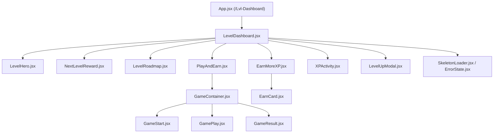

# VELoop Rewards — Task 16: Level-Up Dashboard Redesign

> **Platform:** [VELoop Rewards](https://www.velooprewards.in/Home)  
> **Route:** `/Lvl-Dashboard`  
> **Repository:** [VELoop_Levora](https://github.com/Kumar/VELoop_Levora)  
> **Theme:** Dark Mode (`#161827`) — Fintech Gamified Progression Center

---

## 1. 📖 Project Overview

This project is a complete redesign of the **Level Dashboard** (`/Lvl-Dashboard`) for the **VELoop Rewards** platform (Task 16). 

The goal of this redesign is to transform a passive stat tracker into an active, high-retention **Level-Up + Rewards + Games + Earning Hub**. The dashboard immediately communicates:
1. **Where am I now?** → Current Level & Badge
2. **How far have I progressed?** → Current XP & Count-up Animation
3. **What do I need next?** → Exact XP remaining to level up
4. **What will I receive?** → Next-Level Vault Reward (partially locked to build anticipation)
5. **What level comes next?** → Complete progression roadmap ladder
6. **What can I do right now?** → Play the mini-game arcade & engage with active earning cards
7. **Why should I return?** → Unlock rewards, claim daily streaks, and discover upcoming earning avenues

---

## 2. 🏆 Level System

VELoop Rewards employs an engagement-driven tier ladder. As users earn XP through platform participation, their level progresses, unlocking enhanced platform benefits, multiplier perks, and cashout rewards.

| Level | Name | XP Required | Milestone Reward | Status Representation |
|:---:|:---|:---:|:---:|:---:|
| **L01** | Bronze Starter | 500 XP | 50 VEs | Completed (✓) |
| **L02** | Iron Climber | 1,500 XP | 5 Gems | Completed (✓) |
| **L03** | Steel Achiever | 3,500 XP | 100 VEs | Completed (✓) |
| **L04** | Silver Scout | 8,000 XP | 10 Gems | **Current (★ You Are Here)** |
| **L05** | Gold Guardian | 15,000 XP | 500 VEs | **Next Goal (➔)** |
| **L06** | Platinum Hero | 25,000 XP | 2 Spins | Locked (🔒) |
| **L07** | Diamond Legend | 40,000 XP | 100 SVEs | Locked (🔒) |

---

## 3. ⚡ XP System

* **Current XP:** Displayed prominently with an animated count-up (`6,420 XP`).
* **Progress Bar:** Dynamically animated bar indicating progress (`80%`) with visual glow and countdown.
* **Remaining Calculation:** Users never have to calculate their required XP (`1,580 XP remaining to Level 05`).
* **Anti-Fraud Note:** The system highlights that XP is earned through valid participation; automated scripts or bots trigger penalty rollbacks.

---

## 4. 🎁 Next-Level Rewards (Locked Vault Concept)

The next milestone reward is displayed using a **partially locked vault card**:
* **Anticipation Mechanism:** Displays a frosted lock ring that pulses on hover.
* **Clarity:** Clearly indicates the exact reward (`500 VEs`) and the unlock condition (`Reach Level 05 to unlock`).
* **Transparency:** Accompanied by an `[i]` informational tooltip stating that reward allocations correspond to active platform tier rules.

---

## 5. 🕹️ Game Concept: "VE Coin Rush"

A mandatory, functional frontend arcade mini-game integrated into the dashboard:
* **Format:** 20-second reflex arcade challenge.
* **Action:** Users maneuver a collector cart horizontally across the arena floor to catch falling coins and bonus gems.
* **Safety & Integrity:** Purely skill-based reflex engagement. Contains **zero** casino, gambling, or betting elements.

---

## 6. 📜 Game Rules & Scoring

* **Controls:** 
  * Desktop: Keyboard Left/Right arrow keys, `A` / `D` keys, or mouse hover.
  * Mobile: On-screen touch buttons or direct touch drag in the arena.
* **Duration:** 20 seconds per run.
* **Items:**
  * 🪙 **VE Coin:** +1 point
  * 💎 **Gem:** +3 points
* **Reward Tiers:**
  * Score 10–19: `+15 XP`
  * Score 20–29: `+25 XP`
  * Score 30+: `+35 XP + 1 Gem`
* **Result State:** Visually satisfying result card displaying final score, tier badge, and demo XP earned with an instant replay option.

---

## 7. 💰 Earning Features

A dedicated **"Earn More XP & Rewards"** section converts the dashboard into an actionable hub:
* **Active Features:**
  * 🎮 **Play & Earn:** Play the arcade challenge (`+25 XP`).
  * 📺 **Watch & Earn:** Watch partner video spots (`+20 XP`).
  * 👥 **Refer & Earn:** Share referral link with friends (`+50 XP`).
  * 🎯 **Daily Challenge:** Complete daily missions (`+30 XP`).
  * 🔥 **Streak XP:** Maintain consecutive check-ins (`+15 XP/day`).
  * 📋 **Daily Tasks:** Complete quick micro-tasks (`+40 XP`).
* **Upcoming Features (clearly tagged "Coming Soon"):**
  * 🏆 **Weekly Quest** (`+100 XP`)
  * 🔍 **Reward Hunt** (`+75 XP`)
  * 💡 **Quick Quiz** (`+60 XP`)
* **Personalized Recommendation Banner:** Dynamically informs the user of their remaining XP and recommends the most immediate earning route.

---

## 8. 🛠️ Technology Stack

* **Framework:** React.js 18 (Vite-powered)
* **Styling:** CSS Modules (`.module.css`) + Bootstrap 5 utility foundation
* **Animation:** CSS Keyframe animations + Framer Motion-inspired cubic-bezier easing
* **Icons:** Lucide React + React Icons + Emoji Badges
* **Routing:** React Router v6 (`/Lvl-Dashboard`)

---

## 9. 📦 Installation

```bash
# Clone the repository
git clone https://github.com/Kumar/VELoop_Levora.git
cd VELoop_Levora

# Install dependencies
npm install
```

---

## 10. 💻 Development Commands

```bash
# Start local development server (http://localhost:5173/Lvl-Dashboard)
npm run dev

# Compile production build
npm run build

# Preview production build locally
npm run preview
```

---

## 11. 📁 Folder Structure

```
VELoop_Levora/
├── public/
├── src/
│   ├── assets/
│   ├── components/
│   │   ├── EarnMoreXP/
│   │   │   ├── EarnCard.jsx
│   │   │   ├── EarnMoreXP.jsx
│   │   │   └── EarnMoreXP.module.css
│   │   ├── InfoTooltip/
│   │   │   ├── InfoTooltip.jsx
│   │   │   └── InfoTooltip.module.css
│   │   ├── LevelHero/
│   │   │   ├── LevelHero.jsx
│   │   │   └── LevelHero.module.css
│   │   ├── LevelRoadmap/
│   │   │   ├── LevelRoadmap.jsx
│   │   │   └── LevelRoadmap.module.css
│   │   ├── LevelUpModal/
│   │   │   ├── LevelUpModal.jsx
│   │   │   └── LevelUpModal.module.css
│   │   ├── NextLevelReward/
│   │   │   ├── NextLevelReward.jsx
│   │   │   └── NextLevelReward.module.css
│   │   ├── PlayAndEarn/
│   │   │   ├── GameContainer.jsx
│   │   │   ├── GamePlay.jsx
│   │   │   ├── GameResult.jsx
│   │   │   ├── GameStart.jsx
│   │   │   ├── PlayAndEarn.jsx
│   │   │   └── PlayAndEarn.module.css
│   │   ├── shared/
│   │   │   ├── EmptyState.jsx
│   │   │   ├── ErrorState.jsx
│   │   │   ├── SkeletonLoader.jsx
│   │   │   └── shared.module.css
│   │   └── XPActivity/
│   │       ├── XPActivity.jsx
│   │       └── XPActivity.module.css
│   ├── data/
│   │   ├── earnData.js
│   │   ├── levelData.js
│   │   └── xpActivityData.js
│   ├── hooks/
│   │   ├── useGame.js
│   │   └── useLevelData.js
│   ├── pages/
│   │   └── LevelDashboard/
│   │       ├── LevelDashboard.jsx
│   │       └── LevelDashboard.module.css
│   ├── styles/
│   │   ├── animations.css
│   │   ├── globals.css
│   │   └── tokens.css
│   ├── App.jsx
│   ├── main.jsx
│   └── index.html
├── package.json
├── vercel.json
└── vite.config.js
```

---

## 12. 🏛️ Component Architecture



---

## 13. 📱 Responsive Behavior

* **Mobile (320px–767px):** Single-column stacked hierarchy. Roadmaps scroll horizontally with touch momentum. Arcade includes prominent on-screen left/right controls.
* **Tablet (768px–1023px):** 2-column layout for Hero, grid layouts for earning cards, optimized touch targets.
* **Laptop / Desktop (1024px–1440px):** High-density fintech layout with Roadmap alongside Vault Reward card, multi-column Earning cards, and centered arcade terminal.
* **Large Screens (1440px+):** Centered container max-width `1400px` with ambient glow backdrops.

---

## 14. ✨ Animation Details

* **XP Progress Bar:** Fills from 0% to current percentage on initial load with a 1.2s smooth cubic bezier curve.
* **XP Count-up:** Dynamic number increment from 0 to 6,420 on mount.
* **Gold Badge Pulse:** Subtle recurring ambient pulse on current level badge.
* **Vault Card Shimmer:** Shimmer reflection sweeps across locked reward cards on user hover.
* **Level-Up Celebration:** Triggerable celebration modal featuring golden ring reveal, badge bounce, and ambient sparkles.

---

## 15. 📸 Screenshots & States

1. **Desktop Dashboard View:** Full high-fidelity layout.
2. **Level Progression Hero:** Level 04 badge with animated progress bar and remaining XP indicator.
3. **Locked Next Reward Card:** Partially locked vault card with unlock requirements.
4. **Roadmap Ladder:** Multi-tier path from Bronze to Diamond with state badges.
5. **Arcade Start Screen:** VE Coin Rush rules, scoring tiers, and start button.
6. **Arcade Gameplay Screen:** Live coins falling, countdown timer, collector movement.
7. **Arcade Result Screen:** Score summary with XP reward badge.
8. **Earn More XP Cards:** Actionable cards with hover lift effects.
9. **Level-Up Celebration Modal:** High-impact achievement unlocked modal.
10. **Skeleton Loading State:** Animated pulse placeholders across every component.

---

## 16. 🌐 Live Demo & Deployment

* **Deployment Platform:** Vercel
* **SPA Routing:** Configured with `vercel.json` rewrites for seamless `/Lvl-Dashboard` routing.

---

## 17. 🐙 GitHub Repository

* **Repository:** `https://github.com/Kumar/VELoop_Levora`
* **Clean Branch:** Verified zero secrets or `.env` files committed.

---

## 18. 👤 Author & Task Submission

* **Task:** Task 16 — VELoop Rewards Level-Up Dashboard Redesign
* **Standard:** Built in accordance with all 58 requirements specified in `Level_up_page (5).pdf`.
